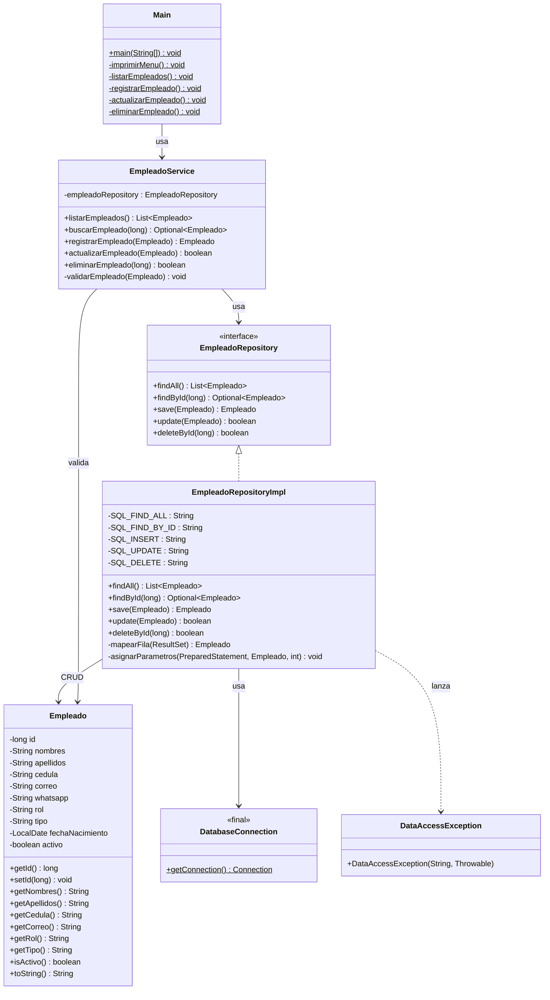

# Diagrama de clases — Módulo Empleados

## Relación con los artefactos previos

- La entidad `Empleado` corresponde a los objetos `empleados` del prototipo (`index.html`, `empleados.html`, `js/app.js`).
- Los casos de uso y las historias de usuario se derivan del rol **Administrador** definido en `MODULES_BY_ROLE`.
- El diseño de pantallas se conserva en los archivos HTML/CSS de la carpeta `Hello Baby KARENB`.
